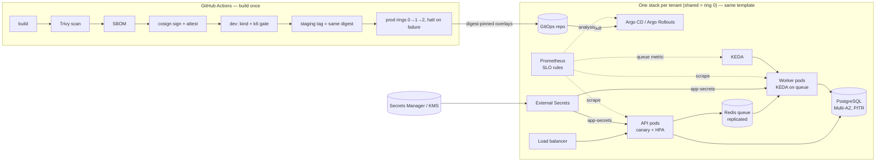

# Architecture — Cloud-agnostic, zero-downtime deployment platform

Status legend used throughout: **[run]** executed with evidence in `docs/evidence/` ·
**[code]** in the repository and validated (`terraform validate`, render, CI) but never applied ·
**[design]** described only. The application is a black box; a synthetic stand-in
(`tests/harness`) implements its contract so platform behaviour can be tested.

## 1. Context and assumptions
API: stateless, :8080, `/healthz` `/readyz` `/metrics`. Worker: stateless, Redis queue, jobs ≤ 60 s.
PostgreSQL with startup migrations, some not backward compatible. Load 150 → 2,250 req/s (15x),
20,000 jobs/h. p95 < 400 ms; availability 99.9 % shared, 99.95 % dedicated; EU data stays in the EU;
$9k/month steady, $16k peak. **Assumptions to confirm with the app owner:** the worker drains on SIGTERM
(finishes or re-queues its job); jobs are idempotent (delivery is at-least-once); startup migrations
can be serialised (advisory lock) or run as a separate step; the queue key is known for KEDA.

## 2. System view

**Request flow:** LB → API pod (readiness-gated) → PostgreSQL via a per-pod pool; enqueue to Redis.
**Job flow:** worker `BLMOVE`s a job from `pending` into its own `processing` list (atomic claim),
runs it, records completion, removes it. A crashed worker's list is re-queued when its heartbeat
key expires, so no job exists only in memory **[run: worker-drain.log]**.

## 3. Layers and portability
| Layer | Contents | Status |
|---|---|---|
| Provider | `infra/providers/aws`: VPC (3 AZ), NAT per AZ, EKS (private endpoint, IRSA, audit logs), RDS PostgreSQL 17 Multi-AZ + PITR, ElastiCache Redis (replicated, TLS, auth), KMS, Secrets Manager, ECR (immutable). `infra/providers/gcp` for CR-001. `infra/bootstrap`: state bucket (versioned, KMS, TLS-only) + GitHub OIDC roles. | [code] |
| Platform | `scripts/platform-addons.sh` (metrics-server, KEDA, Argo Rollouts, pinned), `platform/observability` (Prometheus, SLO rules), External Secrets store, NetworkPolicies | [run] on kind; [code] for EKS |
| Application | `platform/base` (API, worker, PDBs, HPA, ScaledObject, ExternalSecret), overlays per target and per tenant | [code]; harness equivalent [run] |

Every provider root exposes the same outputs (cluster, workload identity, Postgres endpoint,
`app-secrets`, image repository), so layers above do not know the cloud. **Two targets:** kind is
exercised end to end **[run]**; AWS is validated but never planned or applied (no account in scope).
**Not portable** (rebuilt per cloud): networking/NAT/endpoints, IAM/IRSA vs Workload Identity, managed
Kubernetes add-ons and node autoscaling, RDS vs Cloud SQL, ElastiCache vs Memorystore (no cross-region
replication on GCP), KMS, secret store backend, load balancers/ingress annotations, DNS failover,
storage classes, quotas and pricing. Portable: images, manifests, Rollouts/KEDA/ESO objects, Prometheus
rules, the pipeline.

**Full automation.** Empty account → bootstrap root (local state, then migrated into the bucket it
created) → per-stack `terraform apply` from `infra/live/<stack>` → `platform-addons.sh` → GitOps sync.
Remote state: S3 with native lockfile, versioning, KMS **[code]**. Drift: nightly
`plan -detailed-exitcode` per stack with a read-only OIDC role, issue on drift (`drift.yml`) **[code,
not run]**. Console steps that remain by design: creating the AWS account and setting GitHub
environment reviewers.

## 4. Delivery
**Pipeline** (`.github/workflows/ci.yml`) **[run on GitHub Actions; prod rings render overlays only]**: validate → build once →
scan the pushed digest (HIGH/CRITICAL with fix fails) → CycloneDX SBOM → cosign keyless sign + SBOM
attestation → **dev**: verify signature, deploy the digest to an ephemeral kind cluster, k6 gate
(p95 < 400 ms, errors < 0.1 %) → **staging**: re-verify, tag the same digest → **production**: one ring
at a time (`tenant.py rings`: shared → dedicated ring 1 → ring 2), fail-fast cancels later rings,
environment reviewers approve. Only a scanned image gets signed and every deploy verifies the
signature, so nothing unscanned can be promoted.

**GitOps (pull).** CI produces digest-pinned overlays; the cluster pulls them. Production cluster
credentials never live in CI, and git history is the audit and rollback log.

**API: canary** (Argo Rollouts) 25 % → 60 s → 50 % → 60 s → 100 %. Background analysis every 15 s on
canary pods only: 5xx ratio ≤ 1 % (one failure aborts) and p95 < 400 ms (two failures abort). Abort =
canary scaled away, stable keeps 100 % **[run: canary-under-load.log, canary-auto-rollback.log]**.
On kind, weights are replica ratios; on EKS an ALB/mesh router gives exact percentages.
**Worker: rolling** `maxUnavailable 0`, `maxSurge 1`: workers take no traffic, so a canary would only
split queue consumption without a clean signal; safety comes from drain + idempotency, gated by queue age
and failure rate. **Order:** shared stack first, dedicated tenants in rings, then regions; a failed ring
halts the fleet.

## 5. Zero downtime
- **API shutdown:** `preStop` sleep (5 s kind / 10 s prod) keeps the pod serving while endpoints are
  removed; then SIGTERM → readiness 503, stop accepting, finish in-flight, close keep-alives.
  Grace 30/45 s. Startup/readiness/liveness probes; PDB `minAvailable: 2`; `maxUnavailable: 0`.
- **Worker drain:** longest job 60 s < drain budget 75 s < grace 90 s; out of budget → job re-queued,
  never dropped **[run]**.
- **Migrations — expand/contract:** release N adds (nullable columns, new tables, dual-write trigger,
  batched backfill); release N+1 switches reads; contract (drop/rename) only when no old pod remains
  and the rollback window has closed. App rollback after a migration then needs no schema rollback
  **[run: migration-expand-contract.log]**. Startup migrations: run once per release under an advisory
  lock (or as a pre-rollout Job if the image supports a migrate-only mode); `lock_timeout = 5 s` makes a
  blocked DDL fail fast instead of queueing traffic behind it. A truly breaking migration that cannot be
  expanded is a planned maintenance window — zero downtime is not claimed for it.

## 6. Scaling and capacity
**API:** HPA on CPU (60 %), scale-up +100 %/15 s, scale-down stabilised. Doubling every 15 s takes
6 → 48 pods in ~45 s; the remaining budget of the 5-minute target is node provisioning, so stacks keep
**warm headroom** (`app_nodes_min`) for ~5x baseline and Cluster Autoscaler/Karpenter adds the rest.
Replicas = ⌈2,250 / measured req/s per pod⌉ × 1.25 headroom. On kind the harness held 2,250 req/s on
7 pods (~320 req/s/pod, 5 ms simulated work), 0 errors, p95 6 ms, HPA 4 → 8 within ~36 s of peak
**[run: autoscale-15x.log]** — this proves the scaling loop and error-free scale-out, not the real
app's capacity. Planning for the real app uses 100 req/s/pod → 29 pods (shared max 60) until benchmarked.
**Workers:** KEDA on outstanding jobs (pending + in-flight) with one job per worker, not CPU (a worker
waiting on a 60 s job uses no CPU). Little's law: 5.56 jobs/s × 60 s = 334 busy workers worst case,
×1.2 → **400** max (shared). Scale-in is safe because of the drain **[run: autoscale-15x.log]**.

**Database limits.** Peak connections = API pods × pool + workers × 1 + migration 2 + admin 10
= 29 × 5 + 400 + 12 = **557**. RDS `max_connections` on db.r6g.2xlarge ≈ 5,000, but memory per
connection and lock contention make ~500 direct connections the practical ceiling; above that, front
the database with RDS Proxy/PgBouncer (transaction pooling must be tested — prepared statements).
Busy-connection check (Little's law): 2,250 req/s × ~20 ms DB time ≈ 45 concurrent, so pools of 5 per
pod leave 3x headroom. Scaling API pods never fixes a saturated database — the runbook checks the budget first.

## 7. Multi-tenancy and residency
One template, many stacks: `tenants/<name>.yaml` → `scripts/tenant.py` validates (residency ↔ region
allowlist, non-overlapping /16, minimum sizing) and renders `infra/live/<name>` (tfvars + state key in a
same-residency bucket) and `platform/tenants/<name>` (labels, sizing, secret key) **[run locally, in CI]**.
**Onboarding < 30 min:** PR with one file + render (5) → CI check + review (10) → apply runs in
parallel; EKS creation (~15) dominates; RDS Multi-AZ (~20–30) can exceed it, so onboarding uses a
pre-provisioned pool or accepts the DB as the critical path — measured onboarding time is unverified.
**EU:** tenant validation, Terraform precondition on region, backups/snapshots/logs in-region (no
cross-region copies), state in an EU bucket, Prometheus/logs per stack. **Per-tenant visibility:**
every series carries `tenant`/`tier` labels; SLO rules aggregate by tenant.

## 8. Operations
**SLOs:** availability (non-5xx share of requests) 99.9 % shared / 99.95 % dedicated per 30 days
(43.8 / 21.6 min); latency p95 < 400 ms; queue: oldest job < 2 min. **Alerts** (`slo-rules.yaml`,
promtool-checked): multi-window burn rate (1 h & 5 m > 14.4x page; 6 h & 30 m > 6x ticket), p95,
backlog age, duplicates. **Runbooks:** `docs/runbooks.md`. **Backups:** RDS PITR 14 days + snapshots,
in-region; Redis snapshots (queue state is transient). **Restore test:** destroy → restore → checksum
compare **[run: restore-test.log]**; monthly drills into an isolated account [design].

## 9. Decisions and rejected alternatives
| # | Decision | Rejected | Why |
|---|---|---|---|
| 1 | Kubernetes on every target (EKS, kind, GKE) | ECS/Cloud Run per cloud | One deployment contract; kind can exercise it locally |
| 2 | Provider roots per cloud behind one output interface | One "generic" multi-cloud module | Managed services differ; a fake abstraction hides real gaps |
| 3 | GitOps pull for production | Pipeline `kubectl apply` | No prod credentials in CI; git is the audit/rollback log |
| 4 | API canary with metric analysis | Blue/green | Blue/green doubles capacity at 15x scale and still needs schema compatibility |
| 5 | Worker rolling + drain | Worker canary | No traffic to split; correctness comes from drain and idempotency |
| 6 | Expand/contract migrations | Down-migrations on rollback | Down-migrations under load lose data and lock tables |
| 7 | KEDA on outstanding jobs | CPU HPA for workers | CPU does not reflect queued or waiting work |
| 8 | Stack per dedicated tenant from one file | Namespace per tenant in a shared cluster | 99.95 % and residency need blast-radius and data isolation |
| 9 | Human-approved cross-region DB promotion | Automatic regional failover | False positive = split-brain; promotion is irreversible |

## 10. Top five risks
1. **Startup migrations are not backward compatible** — mixed versions during rollout fail; mitigated by
   expand/contract discipline and migration review, but depends on the app team.
2. **Real app performance unknown** — pods/req, DB time and cost are hypotheses until benchmarked; the
   harness proves the platform reacts, not that the app meets p95.
3. **Database is the scaling ceiling** — connections and slow queries saturate before pods do.
4. **Queue durability** — Redis replication is asynchronous; a failover can lose recent jobs and drain
   relies on app support; needs idempotent jobs and ideally a DB outbox.
5. **Cost and parity across tenants/clouds** — every dedicated stack duplicates fixed cost (EKS, NAT,
   Multi-AZ DB); drift between stacks; mitigated by one template, nightly drift plans, cost tags per tenant.
